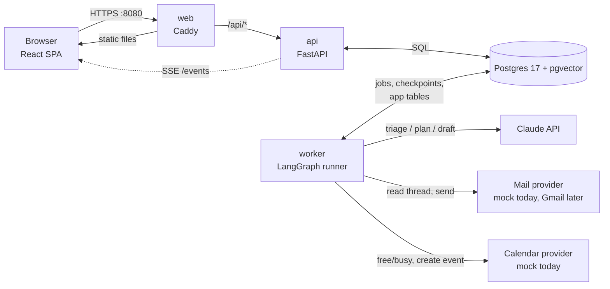
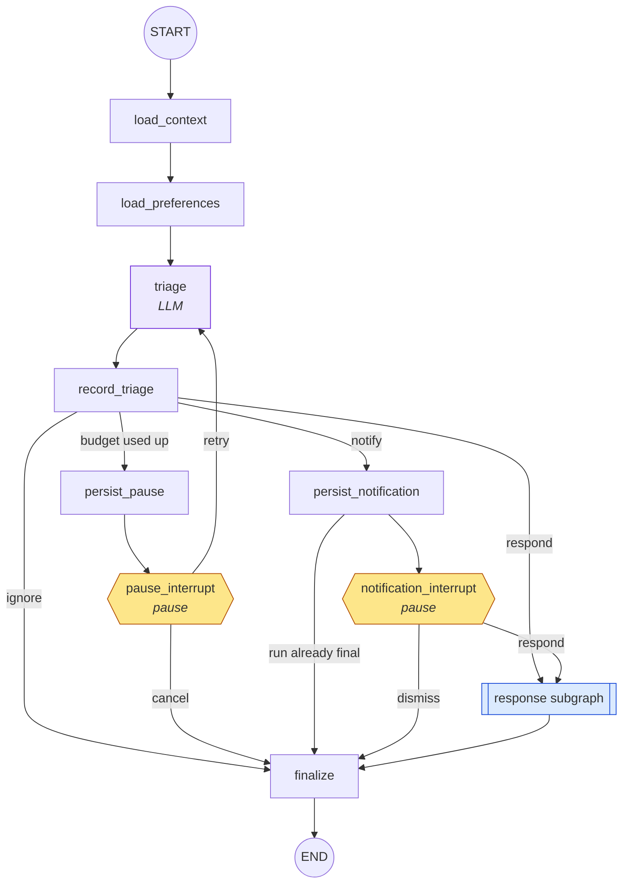
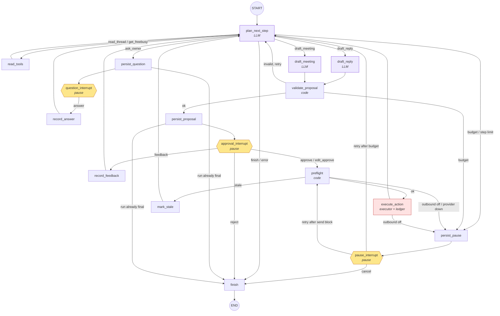
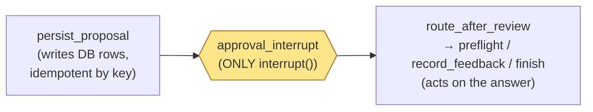
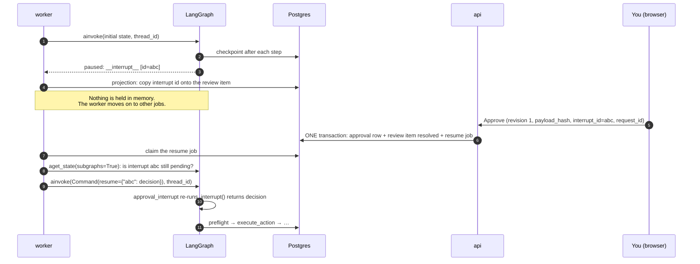
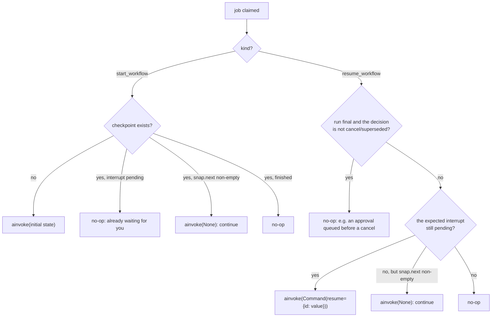
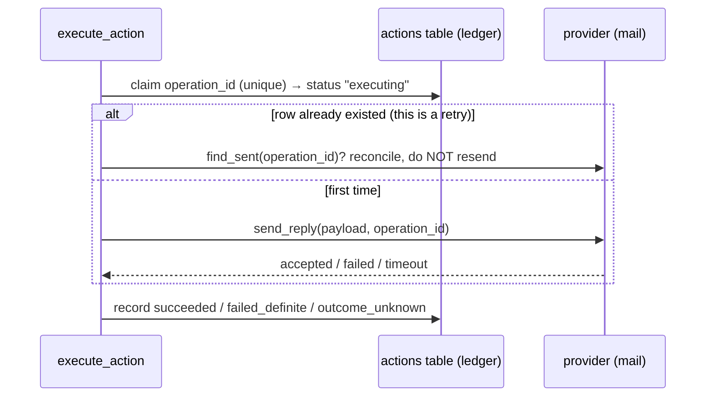

# Learning LangGraph through this project

A teaching guide to the email assistant. It covers how the project is designed, what each
LangGraph idea means, why the code uses it the way it does, and the mistakes we hit along the
way.

> **How to read this.** Part 1 shows the whole system. Part 2 teaches LangGraph from first
> principles. Each lesson starts with a tiny standalone example, then shows the same idea
> in this codebase. Part 3 follows one real email through every node. Part 4 lists the traps.
> Part 5 has exercises. Every toy example was run against the LangGraph version this project
> pins (**1.2.24**), and the outputs shown are the real ones.
>
> The diagrams are [Mermaid](https://mermaid.js.org/): they render on GitHub and in VS Code
> (with a Mermaid preview extension).

---

## Contents

- [Part 1: The project at a glance](#part-1-the-project-at-a-glance)
- [Part 2: LangGraph, lesson by lesson](#part-2-langgraph-lesson-by-lesson)
  1. [Graphs, nodes and state](#lesson-1-graphs-nodes-and-state)
  2. [Reducers: when an update merges instead of overwriting](#lesson-2-reducers)
  3. [Runtime context: dependencies that are not state](#lesson-3-runtime-context)
  4. [Edges, routers and loops](#lesson-4-edges-routers-and-loops)
  5. [Subgraphs](#lesson-5-subgraphs)
  6. [Human in the loop: `interrupt` and `Command(resume=...)`](#lesson-6-human-in-the-loop)
  7. [Checkpointers, threads and durability](#lesson-7-checkpointers-threads-and-durability)
  8. [Crash recovery: continuing a half-finished run](#lesson-8-crash-recovery)
  9. [Side effects: making the outside world safe to retry](#lesson-9-side-effects-and-exactly-once)
  10. [The LLM as a proposer, not an actor](#lesson-10-the-llm-as-a-proposer)
- [Part 3: The life of one email](#part-3-the-life-of-one-email)
- [Part 4: Traps we fell into (and you will too)](#part-4-traps)
- [Part 5: Exercises](#part-5-exercises)
- [Glossary and file map](#glossary-and-file-map)

---

## Part 1: The project at a glance

### What it does

An email arrives. The assistant decides whether it matters (**triage**). If it needs an
answer, the assistant **plans**: it reads the thread, checks your calendar, or asks you a
question. Then it **drafts** a reply or a meeting invite. Code **validates** the draft, and
you **review** it. Only after you approve that exact version does a separate, deterministic
**executor** send it, exactly once.

LangGraph is the engine that runs these steps, pauses for you, and resumes later, possibly in
another process, days later, after a crash.

### The system



The most important design decision is which process does what:

| Process | Runs LangGraph? | Calls the model? | Calls providers? | What it does |
|---|---|---|---|---|
| `api` | no | no | no | stores your decisions, enqueues jobs, serves state |
| `worker` | **yes** | **yes** | **yes** | claims jobs, runs the graph until it ends or pauses |
| `db` | - | - | - | holds *everything* durable: app tables, job queue, checkpoints |

The API never "waits" for the graph, and the graph never waits in memory for you. They
communicate only through Postgres. That is what lets either one restart at any moment.

### Two graphs, one nested in the other



The **parent graph** (`backend/app/graphs/parent.py`) decides *whether* to act. The
**response subgraph** (`backend/app/graphs/response.py`) decides *how*:



Legend: purple = calls the model; yellow = pauses for you; red = touches the outside world;
everything else is ordinary code and database work.

Notice the shape: **a loop around a planner**. The model picks one step at a time. Code runs
that step, then the loop comes back to the planner. Each pass round the loop is checkpointed.

---

## Part 2: LangGraph, lesson by lesson

### Lesson 1: Graphs, nodes and state

**The idea.** A LangGraph program is a *state machine*:

- **State** is a dictionary shape (a `TypedDict`) shared by every step.
- A **node** is a function `state -> partial update`. It returns *only the keys it changed*.
- **Edges** say which node runs next.
- You **compile** the graph, then **invoke** it with an initial state.

```python
from typing import Any, TypedDict
from langgraph.graph import END, START, StateGraph

class S(TypedDict, total=False):   # total=False: every key is optional
    text: str
    words: int
    shout: str

def count(state: S) -> dict[str, Any]:
    return {"words": len(state["text"].split())}      # only what changed

def louder(state: S) -> dict[str, Any]:
    return {"shout": state["text"].upper() + "!"}

g = StateGraph(S)
g.add_node("count", count)
g.add_node("louder", louder)
g.add_edge(START, "count")
g.add_edge("count", "louder")
g.add_edge("louder", END)
print(g.compile().invoke({"text": "hello there"}))
# {'text': 'hello there', 'words': 2, 'shout': 'HELLO THERE!'}
```

`count` never mentioned `text` or `shout`, yet the final state has all three. LangGraph
**merged** each partial update into the state.

**In this project.** The state is `EmailState` in
[`backend/app/graphs/state.py`](../backend/app/graphs/state.py). It is grouped by purpose:

| Group | Keys | Written by |
|---|---|---|
| Identity | `workflow_id`, `account_id`, `provider_message_id`, `provider_thread_id` | the worker's initial input |
| Context | `thread`, `source_version`, `preferences`, `preference_version` | `load_context`, `load_preferences` |
| Triage | `classification`, `urgency`, `decision_summary`, `evidence_refs` | `triage` |
| Planning loop | `next_action`, `step_count`, `read_findings`, `owner_inputs` | `plan_next_step`, `read_tools`, `record_answer` |
| Drafting | `draft`, `draft_kind`, `draft_errors`, `validation`, `validation_attempts` | `draft_*`, `validate_proposal` |
| Review | `proposal_id`, `proposal_revision`, `approval_id`, `review_item_id`, `review` | `persist_*`, the interrupt nodes |
| Outcome | `preflight`, `action_results`, `status`, `error_code` | `preflight`, `execute_action`, `finish` |

Two rules about what may go *in* state:

1. **Only JSON-like values** (str, int, list, dict, None), because state is saved to the
   database after every step. The thread is stored as `ThreadSnapshot.model_dump(mode="json")`,
   not as the Pydantic object.
2. **No live objects and no secrets.** No DB sessions, no HTTP clients, no API keys: those
   would be serialized into checkpoints. They go in the runtime context instead (Lesson 3).

A real node, `load_context` in
[`nodes/context.py`](../backend/app/graphs/nodes/context.py):

```python
async def load_context(state: EmailState, runtime: Runtime[GraphDeps]) -> dict[str, Any]:
    snapshot = await asyncio.wait_for(
        runtime.context.mail.get_thread(state["provider_thread_id"], limit=THREAD_MESSAGE_LIMIT),
        TOOL_TIMEOUT_SECONDS,
    )
    return {"thread": snapshot.model_dump(mode="json"), "source_version": snapshot.version}
```

It reads one key from state, uses a dependency from `runtime.context`, and returns two keys.
That is the whole contract.

---

### Lesson 2: Reducers

**The idea.** By default a returned key **overwrites** the old value. Annotate a key as
`Annotated[T, reducer]`, and LangGraph instead calls `reducer(old, new)` to **combine** them.

```python
import operator
from typing import Annotated

class S(TypedDict, total=False):
    last: str                                   # plain: overwrite
    log: Annotated[list[str], operator.add]     # reducer: old + new

def a(state): return {"last": "a", "log": ["a ran"]}
def b(state): return {"last": "b", "log": ["b ran"]}
# START -> a -> b -> END
print(graph.invoke({"log": ["start"]}))
# {'last': 'b', 'log': ['start', 'a ran', 'b ran']}
```

`last` was overwritten (`"b"` won). `log` grew.

**In this project** there are three reducer keys:

| Key | Reducer | Why |
|---|---|---|
| `owner_inputs` | `operator.add` | Each answer or piece of feedback you give is appended, and the planner cites them as `owner_input:0`, `owner_input:1`, … |
| `action_results` | `operator.add` | Each executed action adds its outcome |
| `read_findings` | `merge_by_key` (custom) | Each tool result has a `"key"`, such as `availability:2026-11-25:2026-11-25`; re-reading the same thing **replaces** it rather than duplicating it |

`merge_by_key` is a good example of writing your own reducer:

```python
def merge_by_key(left, right):
    merged = {}
    for entry in [*(left or []), *(right or [])]:
        merged[entry["key"]] = entry       # later wins; first-seen position kept
    return list(merged.values())
```

Why not just `operator.add` for findings? Because a step can run twice, after a crash or when
the planner asks for the same day's availability again. Appending would leave two copies of
the same fact, so the model would see duplicated evidence. An **idempotent reducer** makes
re-runs harmless. You'll see this theme again in Lesson 9: *design everything so that doing
it twice is the same as doing it once.*

---

### Lesson 3: Runtime context

**The idea.** Nodes need things that are *not* state: an LLM client, database access,
settings, a clock. LangGraph gives every node a second parameter, `runtime`, whose
`runtime.context` is whatever you pass to `invoke(..., context=...)`. The context is **never
checkpointed**.

```python
from dataclasses import dataclass
from langgraph.runtime import Runtime

@dataclass
class Deps:
    greeting: str

async def greet(state, runtime: Runtime[Deps]):
    return {"out": f"{runtime.context.greeting}, {state['name']}"}

g = StateGraph(S, context_schema=Deps)    # declare the context's type
...
await g.compile().ainvoke({"name": "Nika"}, context=Deps(greeting="Hi"))
# {'name': 'Nika', 'out': 'Hi, Nika'}
```

LangGraph injects `runtime` because the parameter is *named* `runtime`.

**In this project.** `GraphDeps` in [`backend/app/graphs/deps.py`](../backend/app/graphs/deps.py):

```python
@dataclass
class GraphDeps:
    llm: LLMClient            # real Claude client, or the scripted one in tests/E2E
    mail: MailProvider        # MockMailProvider today, Gmail later
    calendar: CalendarProvider
    sessionmaker: Any         # database access
    settings: Settings        # includes secrets: which is exactly why it is not state
    now: Callable[[], datetime] = field(default=_utc_now)   # injectable clock for tests
```

This is also **the seam that makes the project testable**. Tests pass a `ScriptedLLMClient`
that replays canned answers, mock providers and a fixed `now`. The graph code is identical to
production: only the context differs. When Gmail arrives in phase 4, the graph won't change
at all; `make_deps` will just pass a Gmail provider.

And because the context is not checkpointed, **a resumed run in a brand-new process simply
gets fresh dependencies.** Nothing stale is carried over.

---

### Lesson 4: Edges, routers and loops

**The idea.** `add_edge(a, b)` is unconditional. `add_conditional_edges(a, router, targets)`
calls `router(state)` after `a` and goes wherever it says. An edge pointing backwards makes a
**loop**.

```python
def step(state):   return {"n": state.get("n", 0) + 1}
def router(state): return "step" if state["n"] < 3 else "__end__"

g.add_edge(START, "step")
g.add_conditional_edges("step", router, ["step", END])
print(g.compile().invoke({"n": 0}))     # {'n': 3}
```

**The golden rule for routers: pure functions of state.** No database reads, no clock, no
randomness. Then the path a run took can always be explained from its saved state, and
replaying a checkpoint takes the same branch.

**In this project**, every decision is a router:

| Router | File | Decides |
|---|---|---|
| `route_after_triage` | `nodes/triage.py` | respond → `response`, notify → `persist_notification`, else → `finalize` |
| `route_after_plan` | `nodes/plan.py` | maps the model's chosen action to a node; **unknown → `error`** |
| `route_after_validate` | `nodes/validate.py` | ok → `persist_proposal`; invalid → back to the planner (once) |
| `route_after_review` | `nodes/proposal.py` | approve → `preflight`, feedback → `record_feedback`, reject → `finish` |
| `route_after_preflight` | `nodes/execute.py` | ok → execute, stale → `mark_stale`, blocked → `finish` |

`route_after_plan` is worth studying, because it is where **the model's choice meets code's
control**:

```python
_ROUTES = {
    "read_thread": "read_tools", "get_freebusy": "read_tools",
    "ask_owner": "persist_question",
    "draft_reply": "draft_reply", "draft_meeting": "draft_meeting",
    "finish": "finish", "budget_stop": "budget_stop", "error": "error",
}

def route_after_plan(state):
    return _ROUTES.get(state.get("next_action") or "", "error")
```

The model can only *name* one of a fixed set of next steps (enforced by the `NextStep` schema),
and anything unexpected becomes `error`. The model never chooses an arbitrary node.

**Loops need brakes.** The planner loop has three:

1. **Step budget.** `plan_next_step` checks the steps taken against `MAX_AGENT_STEPS` (10)
   *before* spending money on a model call, and stops with `budget_stop`.
2. **Validation retry cap.** `validate_proposal` allows one retry (`MAX_VALIDATION_RETRIES = 1`);
   after that the run ends with `error`, not an infinite redraft.
3. **Money budget.** The LLM client reserves the estimated cost against `DAILY_BUDGET_USD`
   before every call, and the run pauses when it would be exceeded.

A brake that fires is a **pause, not an ending**. The run goes to `persist_pause` (records
"paused, because …" on the run) and then waits at `pause_interrupt`, exactly like a review.
The owner's **Retry** resumes it: after a budget stop the planner continues (with a fresh step
allowance), and after a blocked send (outbound off, provider down) the run goes back to
`preflight` with the *same* approval, so every pre-send check runs again and the model is not
asked to redraft. A run that ended at `finish` could never be continued; a run waiting at an
interrupt always can. See `backend/app/graphs/nodes/pause.py`.

---

### Lesson 5: Subgraphs

**The idea.** A compiled graph can be added as a node of another graph. When the subgraph
uses the **same state type**, it reads the parent's state directly and its final state flows
back into the parent.

```python
g.add_node("response", build_response_graph().compile())   # parent.py
```

**Why split at all?** Separation of concerns. The parent answers *should we act?*, a short,
mostly linear flow. The subgraph is the agent loop: *how do we act?* Each can be read,
tested and diagrammed on its own (see the two diagrams in Part 1).

**Two subtleties this project documents:**

1. **Interrupts propagate.** An `interrupt()` inside the subgraph pauses the *whole* run, and
   the resume goes through the parent. When inspecting a paused run you must look inside
   subgraphs: the worker calls `graph.aget_state(config, subgraphs=True)` to find pending
   interrupts.
2. **Reducers apply twice at the boundary.** The subgraph's final state is written back
   through the parent's channels, so reducer keys merge again. The subgraph starts with the
   parent's `owner_inputs` and returns the *whole* list, and `operator.add` then appends that
   to the parent's copy. It is harmless **only because** nothing before `response` writes
   `owner_inputs` or `action_results` (the comment above `add_node("response", ...)` in
   `parent.py` warns future editors). `read_findings` merges by key, so it is safe either way.

---

### Lesson 6: Human in the loop

This is the heart of the project, and the concept most worth understanding deeply.

**The idea.** Calling `interrupt(value)` inside a node **stops the run**. The state is
checkpointed and `value` is handed to the caller. Later, you call the graph again on the same
thread with `Command(resume=answer)`. LangGraph reloads the checkpoint, **re-runs the
interrupted node from its first line**, and this time `interrupt()` *returns* `answer`.

```python
from langgraph.types import Command, interrupt
from langgraph.checkpoint.memory import InMemorySaver

def write_draft(state): return {"draft": "Tuesday works.", "log": ["drafted"]}

def ask_owner(state):
    print("  ask_owner is running (it runs again on resume!)")
    answer = interrupt({"question": "Send this?", "draft": state["draft"]})
    return {"decision": answer}

def route(state): return "send" if state["decision"] == "approve" else "__end__"
def send(state):  return {"sent": True, "log": ["sent"]}

# START -> write_draft -> ask_owner -(route)-> send -> END
saver = InMemorySaver()
app = g.compile(checkpointer=saver)
config = {"configurable": {"thread_id": "email-1"}}

paused = await app.ainvoke({}, config, durability="sync")
paused["__interrupt__"]
#   ask_owner is running (it runs again on resume!)
# [Interrupt(value={'question': 'Send this?', 'draft': 'Tuesday works.'}, id='95c3e8e6…')]
(await app.aget_state(config)).next        # ('ask_owner',)

app2 = g.compile(checkpointer=saver)        # a *new* graph object, as in a new process
done = await app2.ainvoke(Command(resume="approve"), config, durability="sync")
#   ask_owner is running (it runs again on resume!)     <-- printed a SECOND time
# {'draft': 'Tuesday works.', 'decision': 'approve', 'sent': True, 'log': ['drafted', 'sent']}
```

Look at the output: **`ask_owner` printed twice.** That one fact drives a strict rule in this
codebase:

> **An interrupt node contains nothing but the `interrupt()` call and pure reads of state.**

If `ask_owner` had saved a review item to the database before calling `interrupt()`, the
resume would save a *second* one. So the work is split into three nodes:



The real one, [`nodes/proposal.py`](../backend/app/graphs/nodes/proposal.py):

```python
def approval_interrupt(state: EmailState) -> dict[str, Any]:
    """Pause until the owner decides. Nothing else belongs here: it re-runs on resume."""
    value = interrupt({"type": "approval", "review_item_id": state["review_item_id"]})
    return {"review": value}
```

The same pattern appears three times: `persist_question → question_interrupt`,
`persist_notification → notification_interrupt` and `persist_proposal → approval_interrupt`.

**How a resume is delivered in this app (end to end):**



Two refinements worth noticing:

- **The resume is keyed by interrupt id** (`Command(resume={interrupt_id: value})`, a "resume
  map"), not a bare value. If, by the time the job runs, a *different* interrupt were pending,
  your approval could not accidentally answer it.
- **The approval is recorded by the API, not by the graph.** Your decision is stored, bound to
  the exact revision and payload hash you saw, *before* the graph even wakes up. The graph only
  learns the outcome.

---

### Lesson 7: Checkpointers, threads and durability

**The idea.** A **checkpointer** saves the graph's state after every step. It records the
values, *which nodes run next*, and any pending interrupts. Checkpoints are grouped by a
**`thread_id`**, which you pass in `config`. Invoke again with the same thread id and you
continue that run; use a new id and you start a new one.

From the toy above, the history of thread `email-1`:

```python
[s.next async for s in app.aget_state_history(config)]
# 5 checkpoints: [(), ('send',), ('ask_owner',), ('write_draft',), ('__start__',)]
#                 ^ newest: nothing left to run              oldest ^
```

Every arrow in the graph produced a saved snapshot. That is what makes pause-for-days,
crash-recovery and time-travel debugging possible.

**In this project:**

| Concept | Here |
|---|---|
| Checkpointer | `AsyncPostgresSaver` in the worker; `InMemorySaver` in graph tests |
| Its tables | `checkpoints`, `checkpoint_blobs`, `checkpoint_writes`, created by `python -m app migrate` |
| `thread_id` | `f"{account_id}:{provider_message_id}:wf2"`: **one email = one run = one thread** |
| `wf2` | `GRAPH_VERSION`. Changing the graph's shape bumps it, so old checkpoints are never resumed by incompatible code |

**Durability modes** control *when* a checkpoint is written:

| Mode | Writes the checkpoint… | Risk |
|---|---|---|
| `"exit"` | only when the run ends or pauses | crash → lose the whole run's progress |
| `"async"` | in the background while the next step runs | crash → may lose the last step |
| **`"sync"`** | **before the next step starts** | crash → lose at most the step that was running |

This project always passes `durability="sync"`, which costs a little latency per step.
The guarantee it buys: **a completed step is never re-run**, so its side effects are never
repeated by replay. The only step that can run twice is the one that was in progress during a
crash, and Lesson 9 makes that one safe too.

**Why the UI never reads checkpoints.** Checkpoints are LangGraph's private format, and they
change with the graph. Instead, nodes *project* what the UI needs into ordinary app tables
(`review_items`, `proposals`, `workflow_events`), and the API reads those
([`backend/app/api/views.py`](../backend/app/api/views.py)). Think of checkpoints as the
engine's memory and the app tables as its public record.

---

### Lesson 8: Crash recovery

**The idea.** If a process dies mid-run, the last checkpoint says what should run next
(`snapshot.next` is non-empty) and there is no pending interrupt. Calling
**`ainvoke(None, config)`** means "continue from the last checkpoint". Only the unfinished
step runs again.

The worker's decision table for a job ([`backend/app/jobs/worker.py`](../backend/app/jobs/worker.py)):



Around this sits a **durable job queue** in Postgres. A worker *leases* a job for
`WORKER_LEASE_SECONDS`. If the worker dies, the lease expires and another worker claims the
job. A job is attempted at most 5 times. Then the run is marked failed, or `outcome_unknown`
if an external write might have happened.

The E2E journey "8: a worker restart keeps the pending draft" proves the whole chain: the
worker is restarted with `docker compose restart worker` while a review is pending, the
approval still sends exactly once.

---

### Lesson 9: Side effects and exactly-once

LangGraph gives you **at-least-once** execution of a step: a crash can re-run the step that was
in flight. Sending an email twice is not acceptable, so the project makes every side effect
**idempotent**, meaning that doing it twice equals doing it once.

| Side effect | How a re-run is made harmless |
|---|---|
| Create a proposal | unique `idempotency_key = f"{workflow_id}:{step_count}"`; a re-run finds the existing row |
| Create a question or notification review item | deterministic id `uuid5(workflow_id, "question:{step}")`, insert `ON CONFLICT DO NOTHING` |
| Record triage on the run | a plain `UPDATE` (same values twice = same result) |
| Emit events | append-only log, safe to repeat (`node_started` may appear twice after a crash) |
| **Send an email / create an event** | **the action ledger** (below) |

**The action ledger** ([`backend/app/actions/executor.py`](../backend/app/actions/executor.py)):



The order matters: **write the intent before acting, act, then write the result.** A crash
between steps leaves an `executing` row, and the retry *reconciles* (asks the provider whether
the operation happened) instead of sending again. A timeout *after* the provider may have
accepted becomes `outcome_unknown`. The UI then says "Check your Sent folder; the assistant
will not resend automatically". It is honest, and it never guesses.

`execute_action` even consults the ledger **first** on a retry, before re-checking anything
else. An earlier version re-ran its staleness checks first, which could mark an already-sent
email as "stale" and draft a duplicate. That was a real bug found in review (see Part 4).

---

### Lesson 10: The LLM as a proposer

LangGraph doesn't care whether a node calls a model. *How* this project uses the model is a
design lesson of its own:

1. **Structured outputs only.** Every model call returns a Pydantic schema
   ([`backend/app/graphs/schemas.py`](../backend/app/graphs/schemas.py)): `TriageDecision`,
   `NextStep`, `ReplyDraft`, `MeetingDraft`. There is no free text to parse. A malformed
   answer gets one repair attempt, then an error route.
2. **The model proposes; code disposes.** `validate_proposal` is plain Python that checks:
   - every recipient was already in the thread, which defeats a "send this to
     attacker@evil.test" prompt injection;
   - every fact cites evidence (`message:…`, `availability:…`, `owner_input:…`) that exists;
   - a meeting starts exactly on a free slot the calendar actually offered;
   - no header-injection characters appear.
3. **Code derives what the model shouldn't touch.** Subject lines and threading headers
   (`In-Reply-To`, `References`) are computed by code. The model only writes recipients and
   body.
4. **Untrusted text is fenced.** The email thread goes into the prompt inside a marked
   "untrusted data" block, and look-alike delimiters are defused.
5. **An approved payload is never regenerated.** After you approve, no model call happens
   for that payload. Preflight and the executor work on the stored, hashed revision.

The pattern to take away: **put the LLM in a node whose output is data, and let routers,
validators and executors (plain code) decide what that data is allowed to cause.**

---

## Part 3: The life of one email

Follow the scheduling email "Time for a quick call?" from Lena (fixture `e2e-sched`), with the
state after each step. Values are abbreviated.

**0. Ingestion (API).** `POST /dev/inject` stores the message and enqueues
`start_workflow`. The `WorkflowRun` row is created with status `running`.

**1. The worker starts the graph** with only the identity keys:

```python
{"workflow_id": "04a0…", "account_id": "mock-account",
 "provider_message_id": "e2e-sched-m1", "provider_thread_id": "thr-e2e-sched"}
# config thread_id: "mock-account:e2e-sched-m1:wf2"
```

**2. `load_context` → `load_preferences`** add context:

```python
+ {"thread": {...1 message...}, "source_version": "v1", "preferences": {}, "preference_version": 0}
```

**3. `triage`** (model call, effort `low`):

```python
+ {"classification": "respond", "urgency": "normal",
   "decision_summary": "A scheduling request.", "evidence_refs": ["message:e2e-sched-m1"]}
```

`record_triage` copies classification and reason onto the run row for the queue.
`route_after_triage` → `response`.

**4. `plan_next_step`** (step 0) → `get_freebusy` for one day → `read_tools`:

```python
+ {"step_count": 1, "next_action": None,
   "read_findings": [{"key": "availability:2026-11-25:2026-11-25", "kind": "availability",
                      "candidate_slots": [09:00, 10:00, 11:00 UTC], "retrieved_at": "…"}]}
```

**5. `plan_next_step`** (step 1) → `draft_reply` → **`validate_proposal`**: recipients ⊆ thread,
evidence exists, then `{"validation": {"ok": True}}`.

**6. `persist_proposal`** writes proposal revision 1 (with a payload hash) and a pending
review item, idempotent by `"{workflow_id}:2"`.

**7. `approval_interrupt`** pauses the run:

```python
result["__interrupt__"] == [Interrupt(value={"type": "approval", "review_item_id": "…"}, id="abc…")]
```

The checkpoint is saved and the job completes. The run shows `waiting_review`, and the item
appears under **Reply ready**. *Nothing is running now.* You could restart every container.

**8. You approve.** The API stores an approval bound to `(revision 1, payload_hash,
interrupt abc)` and enqueues `resume_workflow` in the same transaction.

**9. The worker resumes** with `Command(resume={"abc…": {"decision": "approve", ...}})`.
`approval_interrupt` re-runs, returns the decision, and `route_after_review` → `preflight`:

- Is the approval still valid and unconsumed?
- Is the proposal less than 72 hours old?
- Is the thread version still `source_version`? (Have you replied manually meanwhile?)
- Is outbound execution enabled?

All pass → `{"preflight": {"result": "ok"}}`.

**10. `execute_action`** claims the ledger row, sends through the mail provider and records
`succeeded`:

```python
+ {"action_results": [{"status": "succeeded", "provider_ref": "…"}]}
```

**11. `plan_next_step`** (step 2) → `finish`. Then `finalize` sets the run to
`done_with_actions` and emits `run_completed`. The UI shows **Accepted by provider**.

Count the checkpoints: one per step, about 15 for this email. Any of them is a safe point to
crash and resume from.

---

## Part 4: Traps

These all happened while building this project. Each one taught a rule.

| # | Trap | Symptom | Rule |
|---|---|---|---|
| 1 | Doing I/O in a node *before* `interrupt()` | duplicate rows or events after every resume | Interrupt nodes contain only `interrupt()`; do writes in a `persist_*` node before it (Lesson 6) |
| 2 | Appending reducers across a subgraph boundary | lists double in size when the subgraph returns | Only use `operator.add` keys that are empty at the boundary, or use a merge-by-key reducer (Lesson 5) |
| 3 | Re-checking "is the thread stale?" *before* consulting the action ledger on a retry | an already-sent email marked stale → a duplicate draft | On retry, the ledger is the source of truth; check it first (Lesson 9) |
| 4 | Assuming state lives in the process | E2E scripted answers replayed from the start after a worker restart, re-drafting a sent reply | Anything that must survive a restart must be in the checkpoint or the DB. Our fix keyed scripted answers to the checkpointed `step_count` |
| 5 | Resuming with a bare value | a late approval could answer a *different* interrupt | Resume by interrupt id: `Command(resume={id: value})` |
| 6 | Letting the UI read checkpoints | breaks whenever the graph changes | Project into app tables; the API reads those (Lesson 7) |
| 7 | Retrying model errors in two places | 3 SDK retries × 3 worker retries = 9 calls | The SDK retries transient errors; the worker marks the run failed (`llm_transient`) instead of re-running |
| 8 | Non-JSON values in state | serialization errors at checkpoint time | Store `model_dump(mode="json")`, never live objects |
| 9 | Changing the graph shape under live checkpoints | resumes fail or take wrong paths | Bump `GRAPH_VERSION` in the thread id |

---

## Part 5: Exercises

Do them on a branch. Run the graph tests with
`cd backend && uv run pytest tests/graphs -q` (needs `docker compose up -d db`).

**1. Watch a checkpoint history (warm-up).** In a test from `tests/graphs/test_response_graph.py`,
after the graph pauses, print
`[s.next async for s in graph.aget_state_history(config)]`. Match each entry to a node in the
response diagram.
*Hint:* `history[0]` is the newest checkpoint.

**2. Prove the re-run.** Add a `print` at the top of `approval_interrupt`, run
`test_respond_scheduling_full_path` with `-s`, and count the prints. Explain the
count using Lesson 6. Then remove the print.

**3. Add a router branch.** Make triage send `urgency == "high"` notifications to a new node
`flag_urgent` that appends an event before `persist_notification`.
*Hints:*
- Edit `route_after_triage` and the `add_conditional_edges` targets in `parent.py`.
- Wrap the node with `traced(...)`.
- Write the test first: a scripted triage output with `urgency="high"`.

**4. Write a reducer.** `action_results` uses `operator.add`. Write
`append_unique_by_operation` that drops an entry whose `operation_id` is already present, and
explain which crash scenario it would protect against.

**5. Add a read tool.** Add `search_contacts` to `NextStep.action`, a branch in
`_ROUTES`, and an implementation in `nodes/reads.py` that returns a finding with a stable
`key`.
*Think about:* why must the finding have a `key`? (Lesson 2.)

**6. Break it on purpose.** Temporarily move the `create_proposal` call *into*
`approval_interrupt` before `interrupt()`, and run
`test_persist_proposal_replay_is_idempotent` and `test_respond_scheduling_full_path`. Which assertion catches
it? Revert.

**7. Time-travel (advanced).** LangGraph can resume from an *older* checkpoint by passing its
`checkpoint_id` in `config["configurable"]`. In a test, pause at approval, give feedback (which
redrafts), then fork from the checkpoint *before* the feedback and approve the original draft
instead. What does the action ledger do, and why is the payload hash check still important?

---

## Glossary and file map

| Term | Meaning | Where |
|---|---|---|
| **StateGraph** | builder for a graph over a state type | `parent.py`, `response.py` |
| **Node** | function `(state, runtime) → partial update` | `backend/app/graphs/nodes/*.py` |
| **Partial update** | the dict a node returns, merged into state | every node |
| **Reducer** | `reducer(old, new)` used to merge a key instead of overwriting | `state.py` |
| **Router** | pure function of state naming the next node | `route_after_*` in `nodes/` |
| **Subgraph** | a compiled graph used as a node | `add_node("response", …)` in `parent.py` |
| **Runtime context** | per-invocation dependencies, never checkpointed | `deps.py`, `make_deps` in `jobs/worker.py` |
| **`interrupt(value)`** | pause the run and surface `value` | `ask.py`, `notify.py`, `proposal.py`, `pause.py` |
| **`Command(resume=…)`** | continue a paused run with an answer | `jobs/worker.py` |
| **Checkpointer** | saves state after each step | `AsyncPostgresSaver` in `jobs/worker.py` |
| **`thread_id`** | identifies one run's checkpoints | `{account}:{message}:wf2` |
| **Durability** | when checkpoints are written (`sync` here) | every `ainvoke` in `jobs/worker.py` |
| **`ainvoke(None, …)`** | continue from the last checkpoint | crash recovery in `jobs/worker.py` |
| **Projection** | copying graph facts into app tables for the UI | `jobs/projection.py`, `api/views.py` |
| **Action ledger** | write-intent-first table making sends exactly-once | `actions/executor.py` |
| **Proposal / revision** | immutable, hashed draft versions you approve | `actions/proposals.py` |
| **Preflight** | re-checks right before acting | `nodes/execute.py` |

**Reading order for the code** (each file opens with a docstring written for learning):

1. `backend/app/graphs/state.py`: the state and reducers
2. `backend/app/graphs/parent.py`: the top-level graph and the concept list
3. `backend/app/graphs/response.py`: the agent loop
4. `backend/app/graphs/nodes/plan.py` → `reads.py` → `draft.py` → `validate.py`
5. `backend/app/graphs/nodes/proposal.py` → `execute.py`: approval and acting
6. `backend/app/jobs/worker.py`: checkpointer, resume and recovery
7. `backend/tests/graphs/test_response_graph.py`: every behavior above, executable

Further reading: the official docs on
[interrupts](https://docs.langchain.com/oss/python/langgraph/interrupts) and
[persistence](https://docs.langchain.com/oss/python/langgraph/persistence). For a shorter
reference to this repo's concepts, see [`langgraph-concepts.md`](langgraph-concepts.md).
