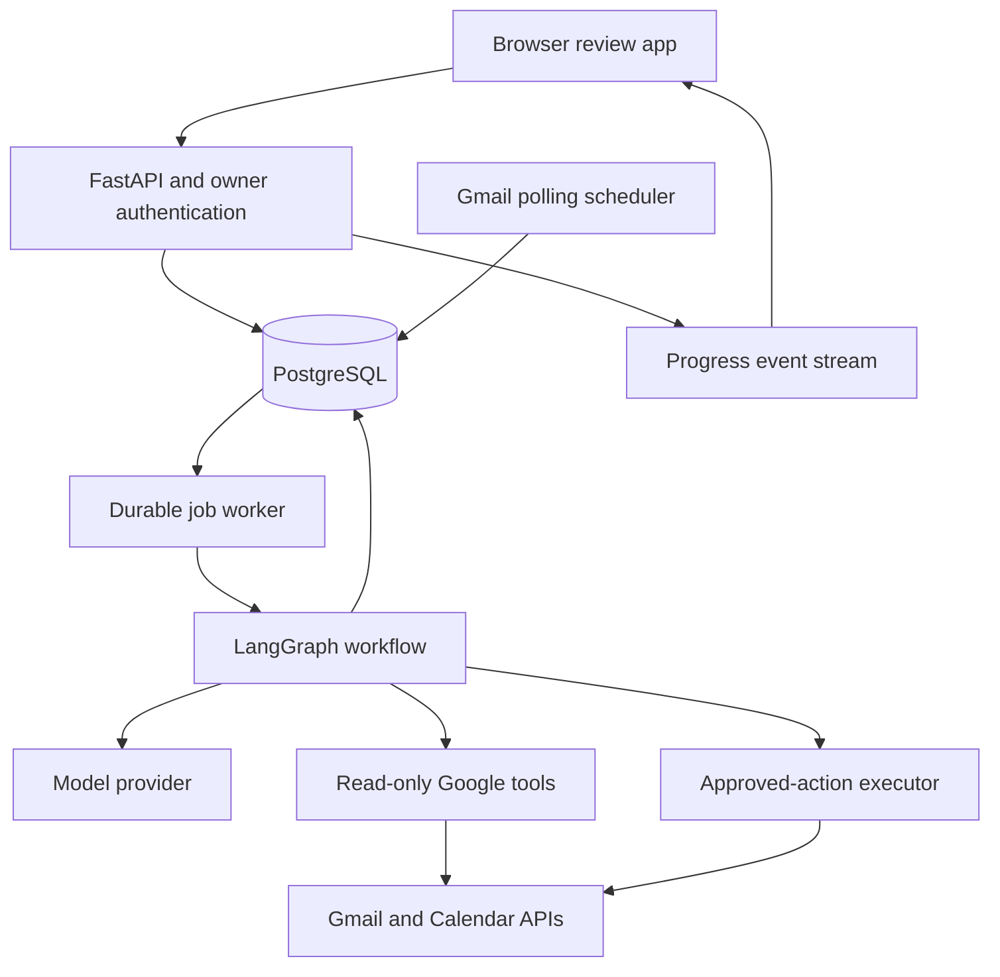
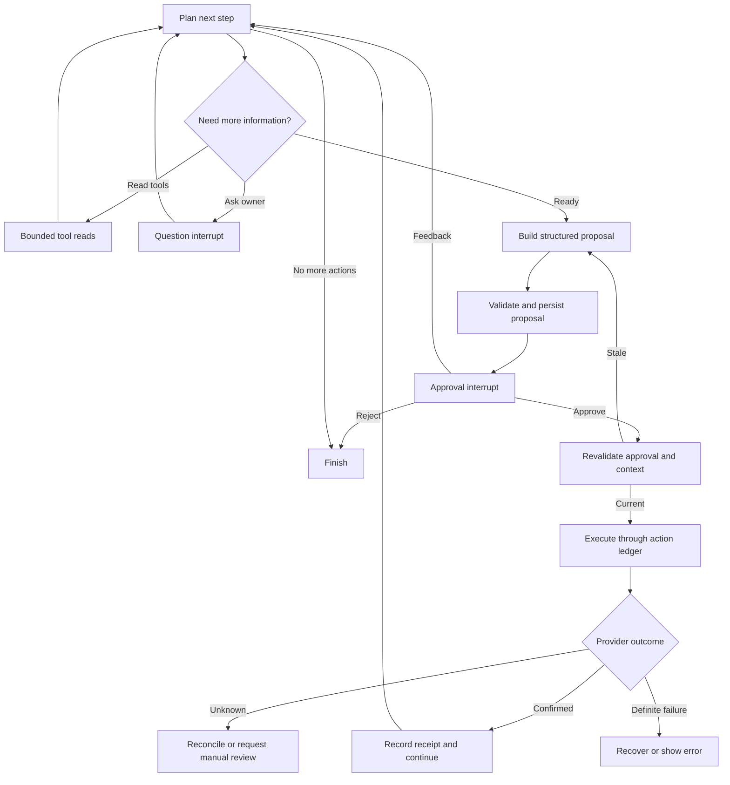

# Personal Email Assistant — Implementation and Product Specification

Version 1.0 · 18 November 2026

This is a proposed build specification, not a completed application or a claim that the reference repository implements every requirement below. It extends LangChain's Agents From Scratch email assistant into a reliable, single-user personal application. Choices, limits, effort estimates, and acceptance thresholds below are recommendations. Provider and framework behavior is linked to primary documentation in the source register.

## 1. Product decision and scope

Build a private web application connected to one Gmail account and that account's primary Google Calendar. It watches selected incoming email, classifies what matters, prepares replies and meeting proposals, and requests approval before any outgoing email or calendar change. It remembers preferences you explicitly save and preferences suggested from your corrections.

Default technical direction: Python 3.12, LangGraph's Graph API, FastAPI, React with TypeScript, PostgreSQL, and Docker Compose. Use a provider adapter for an LLM supporting structured output and tool calls. Start with one model; optimize routing later using evaluation results.

The first usable release is local, has one owner and one account, uses incremental polling, and supports plain-text email plus sanitized HTML display. The mature personal release adds recovery, preferences, cost controls, a responsive review UI, and backup/restore. Always-on hosting is an optional deployment of the same application.

### Release boundaries

| Capability | First usable release | Mature personal release | Later extension |
|---|---|---|---|
| Gmail ingestion and triage | Included | Recovery and reconciliation | Push notifications |
| Reply suggestions | Included | Thread context, revision history | Selected attachment context |
| Review before sending | Required | Versioned approvals and stale-state checks | Explicit per-rule automation policy |
| Calendar | Read availability and propose a time | Approved single-event creation | Reschedule, cancel, recurrence, multiple calendars |
| Preferences | Explicit settings | Suggested updates with review and undo | Contact-specific rules |
| Persistence | PostgreSQL checkpoints and app records | Backups, pruning, recovery | Multiple accounts |
| Knowledge retrieval | Current thread and preferences | Optional selected past conversations | Vector search over opted-in documents |
| Interface | Review queue and thread view | Activity, settings, memory, errors | Mobile app or browser extension |

Automatic sending, deletion, archiving, attachment execution, general web browsing, recurrence management, and external notifications are outside the initial release. These are explicit scope choices to keep the product finishable. An ignored email remains in Gmail unchanged. A notification is an item in the app's review queue; it is not an email sent to someone else.

## 2. Finished product experience

### First run

1. Open the app and sign in as the configured owner.
2. Connect Gmail, then optionally Calendar, through Google OAuth.
3. Choose the monitored inbox/labels, the first-sync lookback, and whether historical items should only be shown or also processed. Default: cache recent context but process only newly arriving eligible messages.
4. Select your time zone, working hours, preferred meeting duration, signature, reply language, and writing style. Default time zone comes from explicit setup or browser detection and is confirmed in the UI.
5. Configure a model provider or local model endpoint on the server. Display what email content is sent to the chosen provider.
6. Run a sample-email demonstration with mock tools.
7. Enable live ingestion; outbound execution remains approval-based.

### Main screens

| Screen | Required contents and behavior |
|---|---|
| Review queue | Filters for Reply ready, Needs information, Notifications, Failed, and Completed; sender, subject, received time, classification, and a short evidence-based reason; connection and last-sync status |
| Thread workspace | Sanitized conversation, editable draft, recipient/CC controls, subject, exact text to be sent, relevant calendar slots, and source references for factual statements |
| Review actions | Approve and send, Edit and approve, Give feedback, Answer question, Dismiss, and Cancel pending action; labels reflect the action actually taken |
| Meeting review | Calendar, title, date, start/end time, time zone, attendee addresses, location, invitation-notification behavior, and a fresh availability check |
| Activity | A readable timeline of reads, proposals, approvals, provider results, and errors; distinguish Proposed, Approved, Accepted by provider, Failed, and Outcome unknown |
| Preferences | Triage rules, tone, language, signature, scheduling rules, saved facts, suggested updates, provenance, and delete/undo controls |
| Settings | Google connection and reauthorization, model configuration, budget, polling interval, retention, pause ingestion, pause outgoing actions, export, disconnect |
| Developer view | Graph state, node transitions, redacted tool inputs/results, run/checkpoint IDs, token usage, prompt versions, and a replay-in-simulation action |

On a narrow screen, stack the thread and draft; keep the approval control adjacent to the reviewed proposal. All buttons must have keyboard-accessible labels. Changing a proposal invalidates its previous approval. Do not display raw chain-of-thought; show short decision summaries, source excerpts, tool results, and validation outcomes.

### Example complete journey

An incoming message asks for a 30-minute call tomorrow afternoon. The app loads the conversation and scheduling preferences, queries free/busy, and proposes two suitable times. It asks you to clarify the sender's time zone if it cannot establish one. You edit the reply and approve the exact text. The executor sends it and stores the Gmail receipt. A later message confirms a time. The next workflow proposes an event, shows its attendees and invitation behavior, asks for approval, and creates it. If a confirmation email is also needed, that is a separate proposed action with separate approval and a dependency on the confirmed event creation.

## 3. What you need before implementation

| Requirement | Purpose |
|---|---|
| Git and a repository | Source control, reviews, CI, versioned prompts and migrations |
| Python 3.12 and uv | Backend runtime and a reproducible dependency lock |
| Current compatible Node LTS and a package manager | React development and frontend build; lock dependencies |
| Docker with Compose | Run PostgreSQL and application processes consistently |
| Google account | The owner mailbox and optional calendar |
| Google Cloud project | Enable Gmail API and Calendar API; configure OAuth |
| OAuth client | A web application client for the proposed browser product; the tutorial's desktop client is for its local script flow |
| Model access | A provider API key with a usage budget, or suitable local model hardware |
| Development mailbox/test calendar | Real integration tests without using important conversations |
| Persistent disk and backup destination | Database durability and recovery |
| Optional HTTPS domain | Required for convenient remote web access; local development can use registered localhost redirects |

Planning allowance for the application stack without a local LLM: roughly 4–8 GB of available RAM is a reasonable starting point, subject to measurement. Local model requirements depend on model size, quantization, context length, and hardware; do not assume the application allowance includes a usable LLM.

### Backend dependencies

Use `langgraph`, the chosen LangChain model-provider integration, `langgraph-checkpoint-postgres`, `psycopg` with pool support, `fastapi`, `uvicorn`, `pydantic`, `pydantic-settings`, SQLAlchemy/Alembic for application migrations, Google auth/OAuth/API client libraries, and an HTML sanitizer. Use the standard-library email parser for MIME. Add `pytest`, async test support, HTTP mocking, and a linter/type checker for development.

Use React, TypeScript, Vite, a server-state/query library, a schema validator, and an accessible component library on the frontend. Playwright covers full UI journeys. Exact dependency versions must be resolved and locked together when building; this document does not invent a tested compatibility matrix. Pin the PostgreSQL image to a supported major/minor policy and run integration tests against that same version.

## 4. System architecture



Run four logical services: web/reverse proxy, API, worker/scheduler, and PostgreSQL. The API accepts requests and records jobs; a separate worker executes the graph. An HTTP request does not need to stay open for the workflow to finish. Use server-sent events (SSE) for progress; a disconnected browser can reconnect and retrieve current state.

For a single-user application, PostgreSQL can hold the durable job queue. This avoids a mandatory Redis service. Implement job leases, heartbeats, uniqueness constraints, and recovery. A task queue library can replace the queue later if its operational benefits justify another service.

The LLM produces proposals and selects allowed read tools. A separate, deterministic executor owns external writes. The model does not possess a generic send-email, database-write, shell, or arbitrary-network capability.

### Responsibility boundaries

| Component | Owns | Does not own |
|---|---|---|
| LangGraph | State transitions, subgraphs, loops, interrupts, checkpoints | OAuth, provider delivery guarantees, job scheduling |
| API | Owner authorization, input validation, review decisions, status | Long-running execution inside request handlers |
| Worker | Durable execution, resume, backoff, budgets, leases | Bypassing approval to recover a run |
| Provider adapters | OAuth refresh, read calls, MIME/calendar serialization | Deciding recipients or policies |
| Action executor | Approval validation, preflight, operation ledger, provider results | Accepting arbitrary model arguments as authorized |
| Frontend | Display, editing, explicit decisions | Tokens, credentials, or trusted approval enforcement |

## 5. Google account integration

### OAuth flow

Use Google authorization-code flow with server-side token exchange, a verified `state` value, exact registered redirect URIs, and offline access when background operation is needed. Use PKCE where supported by the selected flow/library. Bind the connection to the authenticated owner and verified Google subject identifier, not an unverified email string. Store refresh tokens encrypted on the server and keep the encryption key outside the database. Refresh access tokens automatically; revoked/expired credentials put the connection into Reconnect required. [S4]

For a one-owner app, Google's documented Personal mode onboarding may be appropriate if available for your project. Otherwise configure the applicable OAuth audience and test-user path. External apps left in Testing generally receive seven-day refresh tokens when requesting Gmail scopes; include reauthorization handling rather than assuming permanent access. Personal/limited-audience verification exceptions exist; assess the actual console configuration before any broader distribution. [S5, S6]

### Proposed minimal scopes

All shortened scope names below use the `https://www.googleapis.com/auth/` prefix, except OpenID Connect scopes.

| Feature | Scope | Reason |
|---|---|---|
| Identify the owner | `openid email` | Sign-in identity; validate ID token issuer, audience, expiry, and subject |
| Read mail and synchronize | `gmail.readonly` | Fetch bodies, threads, and history |
| Send approved replies | `gmail.send` | Send without broad mailbox modification access |
| Query own availability | `calendar.freebusy` | Avoid reading event descriptions when only availability is needed |
| Create approved events on owned calendars | `calendar.events.owned` | Restrict calendar writes to calendars the user owns |
| Optional Gmail draft synchronization | `gmail.compose` | Only if drafts must appear inside Gmail |

Default drafts live in the application's database. Do not request `gmail.modify` just to support app-internal triage. If a later feature changes labels or read status, request the necessary scope then. The Gmail scope list and Calendar method references are authoritative for scope capabilities. [S1, S2, S3]

### Ingestion and synchronization

1. On connection, persist a mailbox history cursor and first-processing cutoff. Cache a bounded recent snapshot of relevant threads, then catch up changes from the saved baseline so arrivals during setup are not missed.
2. Poll approximately every 60 seconds initially, configurable. Consume all pages of mailbox history since the durable cursor.
3. Fetch added or changed messages as needed, normalize MIME and headers, and upsert provider message IDs under the connected account.
4. Queue eligible incoming items using a unique `(account_id, provider_message_id, job_kind)` key. Record items/jobs and cursor advancement with a crash-safe transaction strategy; never advance past changes that have not been durably recorded.
5. Serialize processing for a Gmail thread. Before proposing or sending, fetch/check the latest relevant thread version to catch manual replies or newer incoming messages.
6. Use a periodic reconciliation sync to repair missed events or provider inconsistencies. If the history cursor is expired and Gmail returns 404, do a bounded full resync appropriate to the chosen scope and then resume incremental sync. [S7]

Do not use the unread flag as the processing ledger: opening an email on your phone must not make the assistant miss it. Compare parsed sender addresses against exact configured owner/alias identities, not substring matches. Suppress self-generated messages, automated reply loops, bounces, and unsupported mailing-list responses. Preserve the distinction between message IDs, Gmail thread IDs, RFC Message-ID headers, and LangGraph thread IDs.

For an always-on server, Gmail watch + Pub/Sub can later trigger the same synchronization job. A push notification is a mailbox-change signal, not the complete email. Renew a watch before its expiration; Google recommends daily renewal and requires renewal at least every seven days. Acknowledge notifications after durable receipt and deduplicate them. Polling remains useful for reconciliation. [S8]

### MIME and reply rules

Decode multipart MIME, charsets, text/plain, text/html, and attachment metadata. Prefer plain text for model input. Sanitize HTML for display and block automatic remote image loading. Bound body length; retain a link to the complete source when truncating. Preserve participants and relevant quoted context; do not blindly discard all quoted text.

Construct outgoing MIME server-side and base64url-encode it for Gmail. To keep replies in the conversation, supply the intended Gmail thread ID, compliant `In-Reply-To`/`References` headers, and matching subject semantics. Validate To/CC addresses and show reply-all changes explicitly. Reject CR/LF header injection and unauthorized From identities. A provider receipt means Gmail accepted the send, not that the recipient read or necessarily received it. [S9, S10]

### Calendar rules

Use IANA time zones and timezone-aware timestamps; store UTC instants plus the original time zone. Resolve relative dates against the email's date and explicit conversational context, and ask when ambiguous. Model output must not silently guess the sender's time zone. Preserve daylight-saving transitions, all-day versus timed events, and end-after-start validation.

Read free/busy, apply working hours and buffers in ordinary code, propose candidate slots, and recheck availability immediately before creation. Free/busy is not an atomic booking lock; another event can appear after the check. Ask for review when a conflict is found. Display the exact attendee list and whether creating the event sends invitations. Keep a stable provider-compatible event ID to help reconcile retries. Start with one-off events on the primary owned calendar; add recurring events only with separate tests and explicit scope. [S2, S3, S11]

## 6. LangGraph workflow design

The parent graph handles ingestion context, triage, notifications, and dispatch. A response subgraph plans read actions, drafts a proposal, validates it, pauses for review, and dispatches an approved action. This is an intentional refactor of the tutorial, which combines more behavior in its tool-interrupt handler. [S0]

### Parent graph

| Node | Input and output | Implementation |
|---|---|---|
| `load_context` | Message reference → normalized thread snapshot and version | Deterministic provider/database read |
| `load_preferences` | Owner → active, versioned preferences | Store lookup |
| `triage` | Thread + preferences → ignore/notify/respond, short reason, evidence | Structured model output with validation |
| `notification_review` | Notification → dismiss or request response | Persisted review record + interrupt |
| `response_subgraph` | Relevant thread state → completed/paused/failed result | Nested LangGraph graph |
| `finalize` | Results → user-visible status and audit event | Deterministic database write |

Triage needs separate notions of urgency and reply requirement. A time-sensitive information message can be Notify, and a routine question can be Respond. If classification is uncertain or contradicts an explicit user rule, route to review. A model's confidence number is not a calibrated guarantee; evaluate decisions on labeled examples.

### Response subgraph



At finalization, distinguish `done_no_action` from `done_with_actions`; preserve any actions already completed in a multi-action workflow even if the owner rejects a later proposed action.

### Nodes and design rules

| Node or concern | Required behavior |
|---|---|
| `plan_next_step` | Return a typed next-action decision; check action, step, token, and time budgets first |
| `read_tools` | Only allowlisted read functions with validated arguments and result-size limits |
| `ask_owner` | Persist a question with the relevant context and wait through `interrupt()` |
| `draft_reply` / `draft_meeting` | Produce typed proposal data; include evidence for names, dates, commitments, and calendar availability |
| `validate_proposal` | Check participants, headers, times, allowed fields, referenced evidence, and unsupported promises |
| `persist_proposal` | Create immutable revision, content hash, and operation identity before approval |
| `approval_interrupt` | Show the saved proposal; perform no external writes; accept only a server-validated decision |
| `preflight` | Verify owner, active revision, approval, expiry, connection, latest thread, and availability |
| `execute_action` | Operate on the approved database revision; never on a fresh model-generated payload |
| `reconcile_action` | Resolve ambiguous outcomes without blindly repeating writes |
| `suggest_memory_update` | Derive a scoped preference candidate from owner feedback; keep it separate from execution authority |

Use `StateGraph`, typed state, conditional routing or `Command`, subgraphs, a durable checkpointer, and a separate store. `interrupt()` requires the runtime to persist the thread and the application to later resume it with `Command(resume=...)`. The interrupted node restarts on resume; code before the interrupt may execute again. Keep external effects out of the approval node. [S12, S13]

### Advanced features with an actual purpose

| LangGraph concept | Use in this product |
|---|---|
| Conditional edges / Command | Triage branches and next-step routing |
| Subgraphs | Reusable response and scheduling workflows |
| Parallel branches / Send | Optional independent context lookups; never parallel conflicting writes |
| Reducers | Merge parallel findings keyed by source/action ID without duplicate accumulation |
| Checkpoints | Resume an interrupted or failed run |
| Store | Read preferences across separate email workflows |
| Interrupts | Approval, clarifying questions, memory suggestions |
| Streaming | Tool progress and draft deltas in the review UI |
| Retry policies | Bounded retries for transient read/model failures |
| Replay/fork | Compare a prompt or model against a saved scenario in simulation |

A personal email assistant does not need ten independent agents. Start with triage plus one response subgraph. Add specialist nodes where state, policy, or tool boundaries justify them.

## 7. State, identifiers, and contracts

Prefer a graph thread per actionable inbound message/workflow. Keep the Gmail conversation ID separately and reload conversation context when needed. Suggested graph ID format: `account-id:message-id:workflow-version`. Maintain an account/conversation lock so multiple workflows cannot propose conflicting actions against the same conversation simultaneously. Invalidate older pending proposals when later messages supersede them.

### Graph state fields

| Field | Type / purpose |
|---|---|
| `owner_id`, `account_id`, `workflow_id` | Internal UUIDs; checked server-side |
| `provider_message_id`, `provider_thread_id` | Gmail identifiers |
| `source_version` | Latest message/version fingerprint used to generate the proposal |
| `messages` | LangGraph conversation messages with a suitable message reducer |
| `classification` | `ignore`, `notify`, or `respond` |
| `decision_summary`, `evidence_refs` | Concise reason and source references |
| `context_refs` | Pointers to normalized email/context records, not unlimited raw documents |
| `preference_version` | Preferences used to build this proposal |
| `read_findings` | Structured calendar/context tool results with source and timestamp |
| `proposal_id`, `proposal_revision` | Immutable proposed action reference |
| `approval_id`, `interrupt_id` | Authoritative review references |
| `action_results` | Operation IDs and provider outcomes |
| `step_count`, `token_usage`, `cost_estimate` | Budget tracking |
| `status`, `error_code` | Application projection and recoverable error classification |

Secrets, OAuth tokens, database credentials, and encryption keys never enter graph state, model messages, browser responses, or traces. The application database is authoritative for approvals and write outcomes; checkpoint state is a resumable workflow snapshot.

### Structured model output examples

```json
{
  "classification": "respond",
  "urgency": "normal",
  "reason": "The sender asks to arrange a 30-minute call.",
  "evidence_refs": ["message:example-inbound-001"],
  "needs_clarification": false
}
```

```json
{
  "kind": "send_reply",
  "provider_thread_id": "example-thread",
  "reply_to_message_id": "example-inbound-001",
  "to": ["friend@example.com"],
  "cc": [],
  "subject": "Re: A quick call",
  "body_text": "I can do Thursday, 19 November 2026, at 15:00 Europe/Paris (UTC+01:00). Does that work?",
  "evidence_refs": ["message:example-inbound-001", "availability:example-query-001"]
}
```

The example uses invented message IDs and availability evidence. In the real application, the date, time, time zone, and evidence must come from verified context. Meeting proposals need `calendar_id`, `title`, `start`, `end`, `time_zone`, `attendees`, `location`, and `send_updates`. The final MIME message and event request are built deterministically from the approved revision.

## 8. Database model

Use application-owned tables plus separately managed LangGraph checkpoint/store tables. Apply application migrations with Alembic; initialize/upgrade the LangGraph persistence components through their supported setup/migration path. Do not invent or directly edit their internal schemas.

| Table | Main fields and constraints |
|---|---|
| `owners` | UUID, verified Google subject, email, timezone, created_at; one allowed owner |
| `connections` | Owner FK, provider account ID, encrypted token payload, granted scopes, expires_at, status, key version; unique owner/provider/account |
| `sync_cursors` | Connection FK, history cursor, processing cutoff, last_success_at, watch_expiry if used |
| `email_threads` | Connection FK, provider thread ID, latest message ID, source version, bounded summary; unique connection/thread |
| `email_messages` | Thread FK, provider ID, RFC Message-ID, sender/recipients, subject, normalized content, received_at, labels, content hash; unique connection/provider ID |
| `workflow_runs` | Graph thread ID, input message FK, graph/prompt/model versions, status, step count, usage, timestamps; unique deduplication key |
| `jobs` | Kind, payload reference, unique dedup key, state, scheduled_at, attempts, lease_owner, lease_until, heartbeat_at, error |
| `proposals` | Workflow FK, kind, immutable revision, exact payload, hash, source/preference versions, expiry, status; unique proposal/revision |
| `approvals` | Proposal revision/hash, owner FK, decision, timestamp, interrupt ID, review request ID; unique accepted decision per revision |
| `actions` | Stable operation ID, approved revision FK, kind, request fingerprint, status, provider request/message/event IDs, attempts, result/error; unique operation ID |
| `preference_versions` | Owner, namespace, revision, value, source feedback IDs, pending/active/deleted status, previous revision |
| `audit_events` | Workflow/action references, event type, redacted detail, timestamp; append-only through application code |

Use JSONB for typed payloads and metadata; use relational columns and constraints for ownership, status, identity, and uniqueness. Index queue scheduling, review status/created_at, thread lookup, and operation lookup. Use timezone-aware timestamps. Apply compare-and-set updates for review and action transitions. Do not hold a database transaction open during a model or provider network call.

Choose one authoritative preference persistence path. With the table layout above, expose `preference_versions` through a LangGraph-compatible store adapter/service. Alternatively, use the standard PostgreSQL Store and keep revision/provenance records there instead of creating that application table. Do not maintain two independently editable copies of the same preference. LangGraph checkpoint storage and business records also need a reconciliation policy: on recovery, reconcile pending interrupts with review rows, and completed provider receipts with graph action results; do not assume a checkpoint and an application transaction commit atomically.

Suggested retention defaults: normalized email bodies and graph checkpoints for 30 days after terminal completion, redacted action/audit metadata for 90 days, and preferences until deleted. Keep active approval/unknown-outcome records until resolved. These are configurable product defaults, not legal requirements. Retention applies to backups and traces as well as application tables.

## 9. Approval and write reliability

### Approval contract

An approval binds the owner to a particular operation type, account, proposal revision, payload hash, recipients/attendees, source context, and expiration. A checkbox saying approved somewhere in graph state is insufficient.

Approval is accepted only if the owner is authenticated, the proposal is still pending, the submitted revision matches, the current interrupt is the expected one, and the action remains allowed. The backend retrieves the canonical payload; the browser does not submit a replacement send payload on an approval-only request. Edit-and-approve creates and validates a new immutable revision and records approval for that revision.

Persist the review decision and a uniquely keyed resume job in one transaction. The worker validates that the graph is at the expected interrupt before resuming. If it crashes after a resume, inspect checkpoint/application status before attempting the same resume again. Duplicate browser clicks return the already accepted outcome instead of starting another operation.

### Action state machine

`proposed → awaiting_approval → approved → executing → succeeded`

Alternative states: `rejected`, `expired`, `stale`, `failed_definite`, `outcome_unknown`, and `cancelled_before_execution`. The UI also needs a partial-completion state when a meeting succeeds but a subsequent email fails. Cancellation cannot recall an already accepted Gmail send; never display a fictitious undo guarantee.

### External side effects

LangGraph retries and checkpoint resume can re-execute node code. They do not make provider writes exactly once. Store the operation identity durably before making the external request and reconcile operation records when resuming. [S14]

For Gmail, an internal idempotency key and a pre-generated RFC Message-ID help correlation but do not make `messages.send` an exactly-once API. If the provider may have accepted a send before a timeout or process crash, mark the outcome unknown. Search/reconcile against sent messages using the stored identifiers and request fingerprint. Absence in a search result is not definitive proof of failure. If ambiguity persists, ask the owner to inspect rather than automatically sending again. Disable automatic write retries hidden inside the HTTP client as well as at graph level. [S15]

For Calendar, derive a stable valid event ID from the durable operation ID. After a timeout, retrieve that ID; if it exists, compare the event with the intended operation. Treat a conflicting payload as a conflict, not success. A repeated insertion using the same ID must not silently create a new ID. Recheck availability before the first attempt, and record notification behavior in the approved payload. [S11]

### Stale context and concurrency

Revalidate the latest thread before sending. If you replied manually in Gmail, or another message changes the request, invalidate the proposal and show what changed. Revalidate the selected calendar slot after approval. Serialize actions for the same conversation and use stable operation claims; a job lease expiring is not evidence that an external write failed.

An existing approved payload is never regenerated by an LLM immediately before execution. Any changed recipient, body, attendee, time, or action requires a new revision and approval. Deterministic checks enforce this boundary.

## 10. Tools and model behavior

### Tool contracts

| Tool | Inputs | Outputs | Access |
|---|---|---|---|
| `get_thread_context` | Authorized account/thread, bounded message limit | Normalized messages and version | Read |
| `search_selected_mail` | Validated query, scope/limit | Snippets with provider references | Optional read |
| `get_freebusy` | Calendar IDs, date range, zone | Busy intervals and retrieval time | Read |
| `get_preferences` | Owner, allowed namespace | Active value and version | Read |
| `propose_reply` | Typed content and evidence | Stored proposal ID/revision | App-internal write |
| `propose_meeting` | Typed event and evidence | Stored proposal ID/revision | App-internal write |
| `ask_owner` | Question and context references | Persisted interrupt | Human input |
| `execute_approved_action` | Operation ID only | Confirmed/failed/unknown result | Server executor only |

The last function is not a freely callable model tool. It loads the approved record under the authenticated owner and enforces policy independently of prompts.

### Prompt responsibilities

Triage prompts classify the need for attention using explicit preferences and quoted evidence. Response prompts use only supported facts, distinguish a proposed time from a confirmed booking, and ask for missing details. Memory prompts extract preference candidates only from owner edits/feedback. Validation should use ordinary code for facts such as allowed recipients, event duration, required fields, and proposal version; an optional critique model can assess tone or unsupported claims but cannot replace code checks.

Version every prompt and output schema. Store model identifiers and parameters with each run. Use brief decision reasons rather than requesting chain-of-thought. Handle malformed structured output with one bounded repair attempt or a clear review/error state.

### Context and budgets

Default to the current conversation, explicit preferences, and selected tool findings. Keep a token budget for each component. Summarize older conversation only when needed and preserve references for dates, commitments, and identity facts. Do not bulk upload the entire mailbox as context.

Starting configurable limits: 10 planning iterations, 3 attempts for transient read/model errors, 60 seconds per tool call, 120 seconds per model call, and a daily model-spend ceiling chosen during setup. These are initial engineering defaults, not measured service guarantees. Human waiting time does not count against execution timeouts. Exceeding a budget pauses the workflow with an explanation and a manual continuation option.

Reserve an estimated maximum call cost before launching each model request and reconcile actual usage afterward. An application-level budget is approximate when providers report usage late or requests remain in flight; use provider-side spend limits where supported and do not promise a mathematically exact billing cap.

## 11. Memory and retrieval

Maintain separate namespaces for triage, writing style, scheduling, and explicit owner facts. Seed them with settings entered during onboarding. A single edit is not automatically a permanent rule: offer Save as preference or a pending memory suggestion. Store each suggestion's source and scope. The owner can accept, edit, reject, disable, or delete it and inspect previous versions.

For a first release, ordinary structured records are sufficient; no vector database is required. If later adding semantic retrieval, index only opted-in content, keep owner/account filters mandatory, attach source IDs, and include deletion/reindexing behavior. Retrieval supplies context, not instructions or permission to send.

A LangGraph checkpointer stores per-thread workflow snapshots; a store supplies data across threads. Neither automatically creates a durable application queue or resolves external-write ambiguity. [S13]

## 12. API and frontend contracts

Use versioned JSON endpoints under `/api/v1`, except the auth callback if desired. Every endpoint verifies the owner and account scope. All mutation requests use CSRF protection for cookie-based sessions and server-side validation. Keep browser and API on the same origin in the final deployment.

| Method and endpoint | Behavior |
|---|---|
| `GET /auth/google/start` | Begin identity/account connection with state |
| `GET /auth/google/callback` | Validate callback, exchange code, save encrypted credentials |
| `GET /connections` | Connection health and granted features |
| `POST /connections/{id}/disconnect` | Pause jobs/writes and revoke/remove connection as requested |
| `POST /sync` | Enqueue deduplicated manual synchronization; return 202/job ID |
| `GET /reviews` | Cursor-paginated pending items with status filters |
| `GET /workflows/{id}` | Current state projection, thread, proposals, action outcomes |
| `GET /workflows/{id}/events` | SSE progress with reconnect cursor |
| `POST /proposals/{id}/decision` | Accept a versioned approve/edit/reject/feedback decision |
| `POST /questions/{id}/answer` | Accept answer and enqueue an idempotent resume |
| `POST /workflows/{id}/cancel` | Stop future work; return completed effects separately |
| `POST /workflows/{id}/retry` | Retry only classified recoverable work; no blind resend |
| `GET /preferences` | Active and pending preferences with versions |
| `PATCH /preferences/{id}` | Version-checked explicit update |
| `DELETE /preferences/{id}` | Remove preference and derived retrieval entries |
| `GET /usage` | Actual token totals and estimated cost by model/date |
| `GET /health/live`, `GET /health/ready` | Process liveness and dependency readiness |

Decision example:

```json
{
  "decision": "approve",
  "proposal_revision": 3,
  "payload_hash": "example-sha256-value",
  "interrupt_id": "example-interrupt-id",
  "request_id": "example-unique-review-request"
}
```

Return 202 for accepted background work; 409 for stale or already superseded revisions; 401/403 for failed authentication/authorization; 422 for invalid fields. Duplicate request IDs return the original outcome. Never expose raw provider exceptions containing secrets.

SSE event types should include `run_started`, `node_started`, `tool_result`, `draft_delta`, `approval_required`, `action_result`, `run_completed`, and `run_failed`. Each event carries an event ID, workflow ID, timestamp, and a small typed payload. Reconnection first fetches authoritative current state; the event stream is not the sole record. Stream draft text only to the owner and never represent a partial draft as approved.

## 13. Code organization

| Path | Responsibility |
|---|---|
| `backend/app/main.py` | FastAPI composition and startup/shutdown |
| `backend/app/config.py` | Validated environment and settings |
| `backend/app/api/` | Auth, connections, review, workflow, preferences, SSE routes |
| `backend/app/auth/` | Owner identity, sessions, CSRF, OAuth flow, token encryption |
| `backend/app/providers/google/` | Gmail/Calendar adapters, MIME, OAuth refresh |
| `backend/app/ingestion/` | Initial sync, history sync, filtering, reconciliation |
| `backend/app/graphs/state.py` | Typed state and output schemas |
| `backend/app/graphs/parent.py` | Parent email graph |
| `backend/app/graphs/response.py` | Response subgraph |
| `backend/app/graphs/nodes/` | Triage, reads, drafting, validation, review, preflight |
| `backend/app/actions/` | Immutable proposals, approvals, operation ledger, executor, reconciliation |
| `backend/app/memory/` | Preferences, suggestions, versioning, optional retrieval |
| `backend/app/jobs/` | Queue, scheduler, leases, heartbeat, resume jobs |
| `backend/app/db/` | Application models, repositories, transaction boundaries |
| `backend/app/prompts/` | Versioned prompt templates and schemas |
| `backend/app/observability/` | Redaction, metrics, structured events |
| `backend/migrations/` | Alembic application migrations |
| `backend/tests/` | Unit, graph, integration, recovery, evaluation tests |
| `frontend/src/` | Queue, thread/review, preferences, activity, settings, API client |
| `frontend/tests/` | Component and end-to-end tests |
| `evals/` | Synthetic/anonymized fixtures, rubrics, regression results |
| `infra/` | Dockerfiles, Compose, reverse proxy, backup/restore scripts |
| `docs/` | Setup, architecture, runbooks, troubleshooting, acceptance checklist |

Example configuration names (values are placeholders, not live credentials):

```dotenv
APP_ENV=development
APP_BASE_URL=http://localhost:8080
DATABASE_URL=postgresql://app:replace-me@db:5432/email_assistant
GOOGLE_CLIENT_ID=replace-me
GOOGLE_CLIENT_SECRET=replace-me
GOOGLE_REDIRECT_URI=http://localhost:8080/api/auth/google/callback
ALLOWED_GOOGLE_SUB=configure-during-owner-bootstrap
TOKEN_ENCRYPTION_KEY=generate-and-store-separately
SESSION_SECRET=generate-and-store-separately
MODEL_PROVIDER=choose-provider
MODEL_NAME=choose-supported-model
MODEL_API_KEY=replace-me
POLL_INTERVAL_SECONDS=60
MAX_AGENT_STEPS=10
OUTBOUND_EXECUTION_ENABLED=false
TRACE_CONTENT_ENABLED=false
```

Do not commit actual `.env` files or tokens. Validate that placeholders are rejected when enabling live execution. An owner bootstrap must be local or otherwise access-controlled; do not let the first arbitrary internet visitor claim ownership. Provider and database adapters may need different DSN prefixes; construct their settings explicitly rather than assuming every library accepts one unchanged URL.

## 14. Data handling and access controls

Incoming email is untrusted data. It cannot alter the system prompt, add tool permissions, select another account, approve itself, or write durable preferences. Requests inside an email to disclose tokens or send unrelated mailbox content are not authorization. Apply server-side tool/argument allowlists and display the exact outbound content.

Encrypt refresh tokens, use owner-only authorization on every object, use HttpOnly/Secure session cookies for HTTPS deployment, enforce CSRF/origin checks, and sanitize rendered HTML. Disable remote images and automatic URL retrieval in the first release. If URL retrieval is added, prevent access to localhost, private networks, cloud metadata, and credential-bearing URLs. If attachments are added, enforce size/type limits and isolated parsing.

Self-hosting the app does not mean the model is local. Cloud-model requests contain whichever email context you send. Make that choice visible. Keep content tracing off by default; record operational metadata and redacted errors. Configure any external tracing provider intentionally. Back up both database and encryption-key recovery material in separate protected locations; document key rotation.

Disconnect pauses ingestion and cancels unexecuted actions, then revokes/removes credentials as selected. Data deletion must include normalized messages, checkpoints, preferences, derived indexes, retained traces where possible, and a documented backup-expiry policy. Never claim immediate removal from already-created backups or from a message recipient's mailbox.

## 15. Failure behavior

| Failure | Required behavior |
|---|---|
| OAuth revoked or refresh fails permanently | Reconnect required; pause affected jobs and writes |
| Model times out or provider returns transient error | Bounded backoff, then visible recoverable error |
| Invalid model schema | One repair attempt, then review/error; never execute malformed data |
| Calendar read fails | Ask/retry; do not invent availability |
| Gmail send times out | Outcome unknown; reconcile; no automatic blind resend |
| Calendar insert times out | Retrieve stable event ID and compare |
| Worker stops while waiting for review | Resume from persisted interrupt after restart |
| Worker stops after successful external write | Recover from action ledger/provider reconciliation, not just graph checkpoint |
| Duplicate sync or approval request | Return/upsert existing record; preserve one logical action |
| New message or manual reply arrives | Mark pending proposal stale and refresh |
| Browser closes | Continue permitted background work; keep approvals pending |
| Database unavailable | Fail closed for writes; preserve provider uncertainty if already attempted |
| Daily budget exhausted | Pause model work; retain queued items and explain why |
| Graph exceeds iteration limit | Stop with a reviewable state and diagnostic summary |
| Upgrade encounters old checkpoint schema | Preserve versioned workflow code or migrate/drain intentionally; never assume compatibility |

## 16. Testing and evaluation

### Test layers

| Layer | Required cases |
|---|---|
| Pure functions | MIME/charset parsing, email address normalization, time zones/DST, date ambiguity, header construction, proposal hashing, policy rules |
| Graph behavior | All triage routes, repeated tool reads, questions, approve/edit/reject/feedback, subgraph resume, loop budgets |
| Persistence | Restart during review; two worker claims; stale leases; duplicate job and decision delivery |
| External actions | Timeout before/after provider acceptance, failed receipt write, ambiguous Gmail send, duplicate Calendar ID, stale approval |
| Google integration | OAuth refresh/reauth, history pagination/404 resync, reply threading, invitation recipients, manual Gmail reply detection |
| UI | Review, edit-and-approve, stale conflict, reconnect, failed/unknown outcomes, keyboard and mobile layout |
| Security behavior | Malicious instructions in email, cross-owner IDs, spoofed callbacks, HTML injection, hidden recipient changes |
| Model evaluation | Triage correctness, supported facts, missing-detail questions, tone preference adherence, and unnecessary tool calls |

Build an initial dataset of 100–200 synthetic or deliberately anonymized messages: promotions, personal requests, FYI updates, scheduling, ambiguous dates, mailing lists, auto-replies, multiple participants, very long threads, non-English text, and adversarial instructions. Use a separate held-out set. Keep fixtures reproducible and versioned; avoid exporting a real inbox to public evaluation services.

Proposed release gates, to be measured rather than claimed:

- 100% of outbound actions in integration tests require a matching active approval.
- Zero duplicate logical actions in deterministic replay/duplicate-delivery tests.
- Every ambiguous Gmail-send test ends in reconciliation or manual review, never a blind automatic resend.
- At least 95% recall for messages labeled Needs response on the held-out set; inspect Notify/Ignore confusion separately.
- No unsupported meeting times, attendees, or factual commitments in reviewed release fixtures.
- Every pending review survives a worker/application restart.
- Daily usage accounting includes model calls, repairs, retries, and memory extraction.
- A backup restores into a fresh environment and can display an existing pending review.

The model-quality thresholds are project targets, not guaranteed performance. Deterministic assertions should enforce approval and duplicate-prevention rules independently of an LLM judge.

## 17. Deployment, operation, and observability

### Local path

1. Build frontend assets and backend image from locked dependencies.
2. Start PostgreSQL with a persistent volume.
3. Apply application migrations and supported LangGraph persistence setup once.
4. Start API and worker; serve the browser app and API under one origin.
5. Bootstrap the owner, connect Google, and run read-only/sample workflows.
6. Enable outbound execution only after approval/recovery tests pass.

If the host sleeps or stops, polling and background work pause. The next start catches up from the cursor; the UI shows the last successful sync so the gap is visible.

### Always-on path

Use the same containers on a small server with HTTPS and authenticated owner access. Keep the database private, provide persistent storage, restart policies, graceful worker shutdown, and encrypted backups. Do not expose the development server as a production deployment. Add Pub/Sub only if polling no longer meets your needs. Hosted LangGraph services are an alternative, not a prerequisite; decide after the local workflow is understood.

### Operational signals

Track last successful sync, queue depth/oldest age, pending-review count, approval age, node latency, model token totals, error rate, unknown actions, stale proposals, and provider quota failures. Log correlation IDs and concise summaries, not full message bodies or credentials. An optional graph tracing service improves learning, but scrub payloads and explicitly choose whether content is uploaded.

Back up daily as an initial policy, test restoration before release, and periodically test it again. Before upgrades, back up, apply schema changes, run compatibility tests, and drain or preserve in-flight graph versions. Provide runbooks for expired credentials, stale cursor, unknown send, database restore, budget exhaustion, and checkpoint incompatibility.

## 18. Costs and performance

The cost centers are model usage, hosting/database, optional tracing, optional push infrastructure, and local hardware/electricity. Running the app on an existing computer avoids a new server subscription; it does not make cloud-model calls free.

Calculate monthly model cost per configured model:

`input_tokens / 1,000,000 × input_price + output_tokens / 1,000,000 × output_price`

Add provider-specific tool, caching, reasoning-token, or minimum-charge behavior where applicable. Use actual usage records and the model's current published pricing when selecting a provider. This document does not quote an unverified current vendor price.

Illustrative workload, not a price quote: 50 eligible emails/day × 30 days × 6,000 input tokens gives 9 million input tokens; at 800 output tokens/email it gives 1.2 million output tokens. Those per-email figures must include all triage, drafting, critique, and memory calls to be comparable. If hypothetical rates were $1/million input and $5/million output, that workload would cost $15 before other services. Replace those hypothetical rates with real provider rates and measure your own tokens.

Reduce cost by filtering deterministic no-action cases, using thread-scoped context, caching safe reads, avoiding repeated drafts, limiting loops, and sending only relevant preferences. Model switching should be based on evaluation, not just advertised price. Record latency separately for queued time, execution time, and time waiting for the owner. A planning target is seconds to tens of seconds for a typical draft, but measure on the selected model and workload before making a product promise.

## 19. Build sequence and effort

These are rough planning estimates for one developer already comfortable with Python and web development, including ordinary tests but excluding unexpected OAuth/deployment issues. A learner may need substantially longer. The ranges sum to approximately 22–39 focused development days for the mature scope; at a few hours per week, calendar time will be much longer.

| Phase | Deliverable | Exit condition | Estimate |
|---|---|---|---|
| 1. Foundation | Repository, schema, provider interfaces, mock email fixtures, CI | Sample workflow runs deterministically | 2–3 days |
| 2. Graph core | Triage, response loop, typed proposals, bounded reads | All routes covered with mock tools | 3–5 days |
| 3. Review and persistence | PostgreSQL, interrupts, review UI, immutable approvals | Restart and duplicate-review tests pass | 4–7 days |
| 4. Gmail | OAuth, sync cursor, MIME, approved sending, reconciliation | Real test-account reply succeeds without duplicate risk | 4–7 days |
| 5. Calendar | Free/busy, slots, approved event creation | Correct timezone and stable-ID recovery | 2–4 days |
| 6. Memory and UX | Preferences, suggestions, activity, errors, cost controls | Edits affect future drafts with explicit memory review | 3–5 days |
| 7. Daily-use release | Evaluation, backups, monitoring, deployment, runbooks | Release gates and full user journeys pass | 4–8 days |

A smaller milestone is a mock-email review assistant after phases 1–3. It teaches graph state, branches, tools, interrupts, persistence, and frontend integration before connecting live services. Add Gmail first, then Calendar; do not begin with multi-account support or a vector database.

## 20. Definition of done and handoff

The finished product must demonstrate all of these journeys:

1. New personal email appears in the queue; the generated reply contains supported facts and correct recipients.
2. Approve sends exactly the stored revision and records a provider receipt.
3. Editing changes the preview/hash/revision; the old approval cannot execute it.
4. Rejecting sends nothing and closes or reclassifies the item visibly.
5. A notification can be dismissed or converted into a reply request.
6. A scheduling request produces timezone-explicit options and an approved one-off event.
7. Missing information causes a question, and the answer resumes the same workflow.
8. Restart during review preserves the pending draft; duplicate review clicks do not repeat the action.
9. An ambiguous provider outcome is shown honestly and can be reconciled.
10. A newer email or manual Gmail reply invalidates a stale proposal.
11. An accepted preference suggestion changes future behavior; deleting it removes that influence.
12. Disconnect stops future access; pause controls stop future ingestion or outgoing work as labeled.
13. Usage and operational health are visible; a backup restores successfully.

Required handoff artifacts: backend and frontend source, locked dependencies, migration scripts, Compose configuration, example environment file, setup guide, OAuth setup instructions, architecture document, anonymized fixtures, tests/evaluation runner, backup/restore scripts, operational runbooks, and a short recorded or scripted demo of the journeys above.

The reference repository supplies a useful learning sequence and initial graph concepts. This specification adds application infrastructure and explicit reliability boundaries. No live mailbox connection, deployment, email send, or calendar write has been performed in preparing this document.

## Primary source register

Checked 18 November 2026. Repository examples and service requirements can change; verify the pinned implementation against these sources when building.

- **S0 — Reference project:** [Agents From Scratch](https://github.com/langchain-ai/agents-from-scratch), [Gmail graph](https://github.com/langchain-ai/agents-from-scratch/blob/main/src/email_assistant/email_assistant_hitl_memory_gmail.py), [Gmail setup](https://github.com/langchain-ai/agents-from-scratch/blob/main/src/email_assistant/tools/gmail/README.md).
- **S1 — Gmail permissions:** [Choose Gmail API scopes](https://developers.google.com/workspace/gmail/api/auth/scopes).
- **S2 — Calendar availability and scopes:** [Calendar authorization](https://developers.google.com/workspace/calendar/api/auth), [Freebusy query](https://developers.google.com/workspace/calendar/api/v3/reference/freebusy/query).
- **S3 — Calendar write method:** [Events insert](https://developers.google.com/workspace/calendar/api/v3/reference/events/insert).
- **S4 — Server OAuth:** [OAuth 2.0 for Web Server Applications](https://developers.google.com/identity/protocols/oauth2/web-server).
- **S5 — OAuth expiration:** [Using OAuth 2.0](https://developers.google.com/identity/protocols/oauth2/).
- **S6 — Personal/limited-audience apps:** [Unverified apps](https://support.google.com/cloud/answer/7454865).
- **S7 — Incremental sync:** [Synchronize clients with Gmail](https://developers.google.com/workspace/gmail/api/guides/sync), [History list](https://developers.google.com/workspace/gmail/api/reference/rest/v1/users.history/list).
- **S8 — Push:** [Configure Gmail push notifications](https://developers.google.com/workspace/gmail/api/guides/push).
- **S9 — Sending:** [Create and send email messages](https://developers.google.com/workspace/gmail/api/guides/sending).
- **S10 — Threads:** [Manage threads](https://developers.google.com/workspace/gmail/api/guides/threads).
- **S11 — Event identity and invitations:** [Create events](https://developers.google.com/workspace/calendar/api/guides/create-events).
- **S12 — Human input:** [LangGraph interrupts](https://docs.langchain.com/oss/python/langgraph/interrupts).
- **S13 — Persistence:** [LangGraph persistence](https://docs.langchain.com/oss/python/langgraph/persistence).
- **S14 — Re-execution:** [LangGraph fault tolerance](https://docs.langchain.com/oss/python/langgraph/fault-tolerance).
- **S15 — Gmail send API contract:** [Messages send](https://developers.google.com/workspace/gmail/api/reference/rest/v1/users.messages/send).
- **S16 — Replay:** [LangGraph time travel](https://docs.langchain.com/oss/python/langgraph/use-time-travel). Replay can re-execute downstream calls. In this project, replay uses mocked external writes or a simulation-only adapter; it is not an undo operation for real email or calendar effects.
- **S17 — Graph primitives:** [Graph API overview](https://docs.langchain.com/oss/python/langgraph/graph-api).
